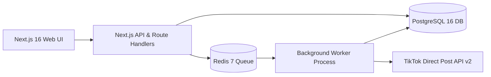

# 🚀 PostPilot

> **Bulk TikTok Publishing & Multi-Account Management Platform**  
> Built as a unified full-stack **Next.js 16** application with **Docker Compose**, **PostgreSQL**, **Redis**, and **BullMQ** background workers.

---

## 📋 Overview

PostPilot solves the repetitive, manual friction creators and social teams face when posting the same video content across multiple TikTok accounts. With PostPilot, creators can:
- **Connect multiple TikTok accounts** using official OAuth 2.0.
- **Upload a single video once** and preview before posting.
- **Bulk publish to all or selected accounts** with custom or shared captions.
- **Schedule drops** across multiple timezones.
- **Monitor real-time progress** via an interactive Job Monitor.
- **Isolate failed accounts** and retry them with exponential backoff without re-running the entire batch.

---

## 🏗️ Architecture & Stack



- **Frontend & Fullstack API**: Next.js 16 (App Router, Turbopack, Tailwind CSS v4, Lucide Icons)
- **Database & ORM**: PostgreSQL 16 with Prisma ORM 7 (`@prisma/adapter-pg`)
- **Queue & Workers**: Redis 7 with BullMQ (`publishWorker`, `scheduleWorker`)
- **Security**: AES-256-GCM token encryption at rest
- **Storage**: Local file uploads with S3/MinIO compatible object storage support
- **Containerization**: Full Docker Compose stack with healthchecks

---

## 🖥️ Primary Screens

1. **Overview Dashboard (`/`)**: System health, workflow pillars, and quick navigation.
2. **Connected Accounts (`/accounts`)**: Authorized TikTok accounts list, status chips (`ACTIVE`, `EXPIRED`, `REVOKED`), follower metrics, and "+ Connect Demo Account" simulator.
3. **Bulk Composer (`/composer`)**: Video drag-and-drop uploader, caption editor with hashtag presets, per-account customization toggles, multi-account checklist, and schedule picker.
4. **Job Monitor (`/jobs` & `/jobs/[id]`)**: Real-time progress ring, per-account status cards (`PENDING`, `UPLOADING`, `PROCESSING`, `PUBLISHED`, `FAILED`), provider error drawer, and one-click "Retry Failed Accounts".
5. **History & Analytics (`/history`)**: Filterable audit log of past publications, delivery success rate, and platform metrics.

---

## ⚡ Quick Start

### 1. Using Docker Compose (Recommended)

Start the entire containerized stack with a single command:

```bash
docker compose up --build -d
```

Services started:
- `web`: http://localhost:3000
- `postgres`: port 5432
- `redis`: port 6379
- `worker`: Background job processor
- `minio`: http://localhost:9001 (Console)

---

### 2. Local Development

#### Prerequisites
- Node.js 20+ (tested on Node 22 / 26)
- PostgreSQL (or run via Docker)
- Redis (or run via Docker)

#### Installation
```bash
# Clone the repository
git clone https://github.com/miteshviras/postpilot.git
cd postpilot

# Install dependencies
npm install

# Copy environment variables
cp .env.example .env

# Generate Prisma Client
npm run db:generate

# (Optional) Seed demo user and accounts
npm run seed
```

#### Running the App
```bash
# Terminal 1: Next.js Web App
npm run dev

# Terminal 2: Background Worker Process
npm run worker
```

Open [http://localhost:3000](http://localhost:3000) in your browser.

---

## 🧪 Testing & Validation

```bash
# Run Unit & Integration Tests (Built-in Node test runner via tsx)
npm test

# Run ESLint validation
npm run lint

# Run TypeScript Typecheck
npx tsc --noEmit

# Run Production Next.js Build
npm run build
```

---

## 📁 Project Structure

```
postpilot/
├── app/
│   ├── accounts/             # Accounts Dashboard screen
│   ├── api/
│   │   ├── accounts/         # GET /api/accounts & DELETE /api/accounts/[id]
│   │   ├── auth/tiktok/      # OAuth connect and callback handlers
│   │   ├── publish-jobs/     # Fan-out dispatcher & job progress endpoints
│   │   └── videos/           # Video file upload & asset creation
│   ├── composer/             # Bulk Publish Composer screen
│   ├── history/              # Post History & Delivery Analytics
│   ├── jobs/                 # Job Progress Monitor screen
│   ├── layout.tsx            # App root layout with brand theming
│   └── page.tsx              # Overview landing dashboard
├── components/
│   ├── AccountBadge.tsx      # Connection status chips
│   ├── Navbar.tsx            # Sticky header with quick actions
│   ├── ProgressRing.tsx      # SVG circular progress ring
│   └── Sidebar.tsx           # Navigation sidebar
├── docs/
│   ├── ARCHITECTURE.md       # Architectural blueprints & diagrams
│   ├── PHASE_PLAN.md         # Phase-by-phase delivery plan
│   └── TIKTOK_BULK_POSTING_PRD.md # Original Notion PRD
├── lib/
│   ├── crypto.ts             # AES-256-GCM token encryption
│   ├── db.ts                 # Prisma Client singleton with PrismaPg
│   ├── queue.ts              # BullMQ queue definitions
│   ├── storage.ts            # Local and S3 storage abstraction
│   └── tiktok.ts             # TikTok API v2 client and simulator
├── prisma/
│   ├── schema.prisma         # Relational database models
│   └── seed.ts               # Sample accounts demo seeder
├── tests/                    # Unit and integration test suite
├── worker/
│   └── index.ts              # BullMQ background worker service
├── Dockerfile                # Multi-stage container build
└── docker-compose.yml        # Docker service orchestration
```

---

## 📄 License
MIT
