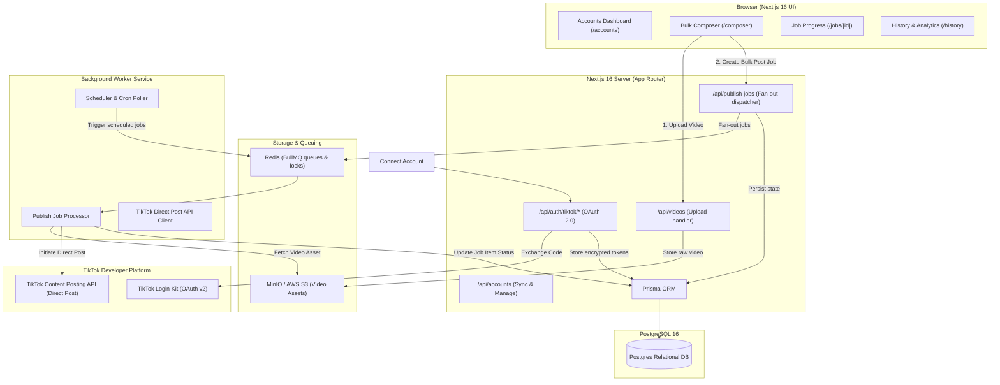

# System Architecture & Technical Specifications

## 1. System Overview

PostPilot is a full-stack Next.js 16 application engineered for multi-account TikTok bulk video publishing, scheduling, background transcoding/upload, and per-account dispatch tracking.

## 2. Docker Topology (`docker-compose.yml`)

The stack is orchestrated using Docker Compose with 4 core services:

1. **`web`**: Next.js 16 App Router application running on Node 20 / 22 Alpine, serving server actions, route handlers, and SSR UI components.
2. **`worker`**: Background worker process running BullMQ queues for handling asynchronous video uploads, TikTok Direct Post API chunked uploads, status polling, and retries with exponential backoff.
3. **`postgres`**: PostgreSQL 16 Alpine container with a persistent volume (`postgres_data`).
4. **`redis`**: Redis 7 Alpine container for BullMQ job queue management and distributed locking (`redis_data`).
5. **`minio`** (optional / local dev): Local S3-compatible object storage for storing uploaded video files before dispatching to TikTok.

## 3. Database Schema (Prisma)

### Key Models:
- **`User`**: Account owner/operator in PostPilot.
- **`TikTokAccount`**: Connected TikTok accounts storing open ID, union ID, display name, avatar URL, encrypted access token, encrypted refresh token, token expiry, scopes, and connection status (`ACTIVE`, `EXPIRED`, `REVOKED`).
- **`VideoAsset`**: Uploaded video files, containing S3/MinIO key, original file name, mime type, size, duration, width, height, and processing status.
- **`PublishJob`**: Top-level batch job representing a single user intent (e.g. 1 video + caption dispatched to $N$ accounts), with status (`PENDING`, `IN_PROGRESS`, `COMPLETED`, `PARTIAL_SUCCESS`, `FAILED`), scheduled time, and summary counters.
- **`PublishJobItem`**: Per-account child job representing the discrete TikTok posting task, containing target account ID, customized or shared caption, TikTok publish ID / share ID, current status (`PENDING`, `UPLOADING`, `PROCESSING`, `PUBLISHED`, `FAILED`), attempt count, error messages, and raw API provider response payload.
- **`Schedule`**: Recurring or scheduled trigger definitions with cron/timestamp and timezone handling.

## 4. TikTok Content Posting API Flow

According to official TikTok Content Posting API guidelines:
1. **Scope required**: `video.publish`, `video.upload`.
2. **Direct Post flow**:
   - `POST /v2/post/publish/video/init/`: Initialize video upload, requesting upload URL and publish ID.
   - Upload chunked video bytes to TikTok's upload URL.
   - Poll `POST /v2/post/publish/status/fetch/` with `publish_id` until status is `SUCCESS` or `FAILED`.
3. **Token Management**:
   - Access tokens expire in 24 hours.
   - Refresh tokens expire in 365 days.
   - Worker automatically checks expiry and calls `/v2/oauth/token/` refresh before dispatching publish jobs.
